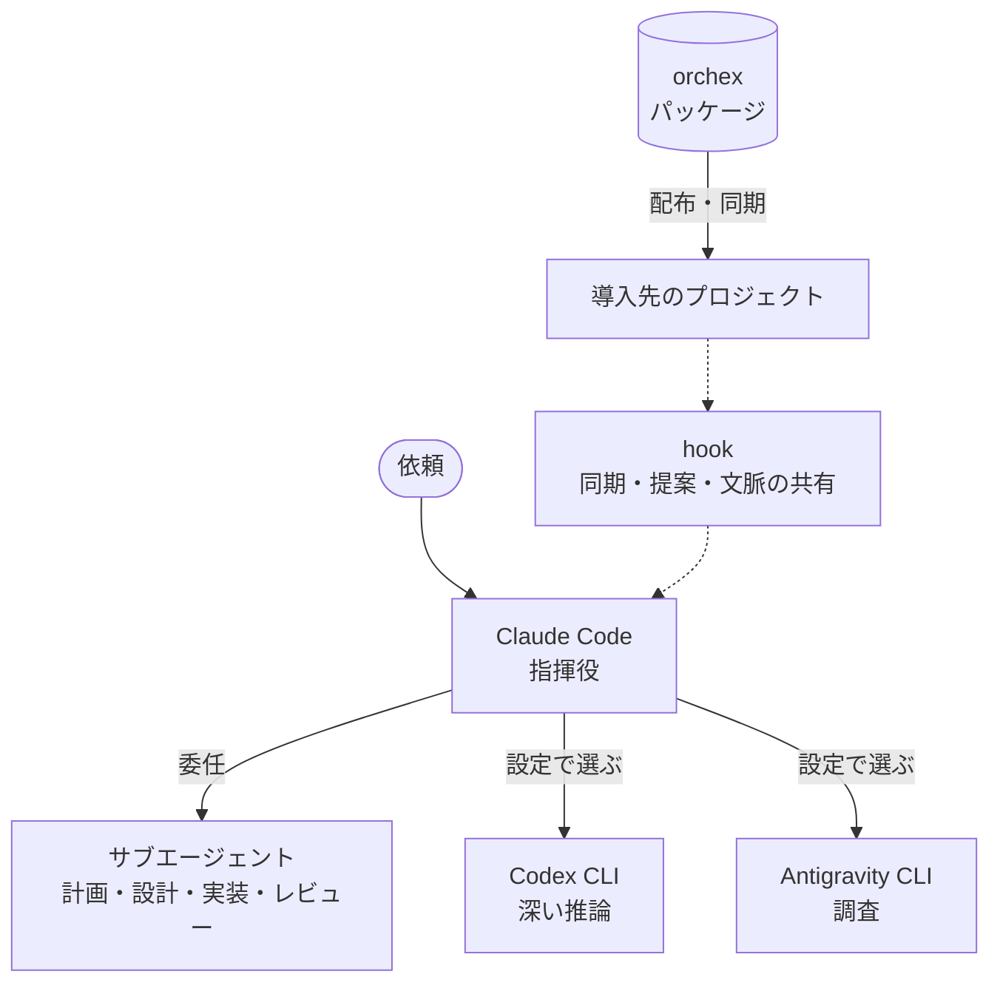

## 概要

orchex は、Claude Code を指揮役にして、Codex CLI や Antigravity CLI と役割を分けながら開発を進めるための基盤です。エージェントの定義、スキル、hook、設定をパッケージにまとめ、`orchex` コマンドで複数のプロジェクトに配って同期します。リポジトリの名前は ai-orchestra で、配る CLI とパッケージの名前が orchex です。

## 課題

【要確認: 作り始めたきっかけ。以下はリポジトリの記述から読み取れる範囲】

AI コーディングのツールを複数使うと、次のことが毎回の手間になります。

- 設計の判断やデバッグ、調べもの、実装など、仕事の種類ごとにどのツールへ任せるかを決める
- 同じルールやスキルを、プロジェクトごと・ツールごとに書き直す
- あるプロジェクトでうまくいった設定を、ほかのプロジェクトに広げる

orchex はこれを、配布できるパッケージと、同期の仕組みで解こうとしています。導入済みのプロジェクトとの互換性を壊さずに、設定と運用を少しずつ進化させることも目的にしています。

## 構成

orchex は AI コーディングの実行基盤を 4 つの層で捉えています。

| 層        | 役割                     | orchex での実体                                                             |
| --------- | ------------------------ | --------------------------------------------------------------------------- |
| Prompt    | 何を指示するか           | 部品（facet）から組み立てるスキルとルール                                   |
| Context   | 何を踏まえるか           | 3 つの CLI が共通で読む `AGENTS.md`、設定の上書き、CLI 間で共有するファイル |
| Harness   | どう実行するか           | hook、エージェントの振り分け、パッケージの配布、外部 CLI との協調           |
| Coherence | 変更が入っても整合を保つ | ドキュメントの依存を宣言し、追従漏れを検出する `codd` パッケージ            |

動くときの関係は次のとおりです。

- hook は環境変数で指した orchex のリポジトリを直接実行します。シンボリックリンクは使いません。
- エージェントの定義と設定は、セッションの開始時に導入先の `.claude/` へ差分だけ写します。
- スキルとルールは、共通の部品と組み立ての定義から `facet build` で生成します。

## 技術選定とトレードオフ

### どの CLI に任せるかは設定ファイルで決める

- 選んだもの: `cli-tools.yaml` を正本にし、エージェントごとに使う CLI を設定で決める
- 選ばなかったもの: 文書に固定の役割を書く。役割の説明を省いて使う人の判断に任せる
- 理由: 文書と実際の設定がずれない。役割を変えるときは設定を書き換えるだけで済む。文書の説明が少し長くなることは受け入れた

### CLI 間の共有はファイルで行う

- 選んだもの: `.claude/context/` に置く JSON ファイル
- 選ばなかったもの: 専用の MCP サーバー、JSON-RPC のサーバー
- 理由: ファイルは 3 つの CLI がそのまま読み書きできる唯一の共通の手段。MCP のツール定義がすべてのエージェントの文脈に常に載り、トークンを圧迫する問題も避けられる。リアルタイムの通知がないことは受け入れた

### スキルとルールを部品から組み立てる

- 選んだもの: Faceted Prompting の考え方を取り入れ、組み立ての仕組みを Python で作る
- 選ばなかったもの: 既存の npm のツールをそのまま使う。スキルの中にファイルの参照を書き、実行時に読ませる
- 理由: 既存の同期の仕組みと自然につながり、同じ部品から Claude Code 向けと Codex 向けの両方を作れる。自作の保守コストは受け入れた

### 効果を測れなかった機能は外す

意味検索の MCP サーバーを自動で入れるパッケージを、2026 年 2 月から配っていました。2026 年 9 月に、使われているかと効果があるかを測りました。

- 直近 30 日の約 1,200 セッションで、意味検索の呼び出しは 0 回でした（同じ期間に Grep と Glob は 600 回以上）
- 約 1,100 ファイルのリポジトリで「どこに実装されているか」を問う質問を、Grep などだけで解く場合と意味検索を足した場合で比べました。正解率に差はなく、意味検索を足した方がコストが 9〜33% 多くかかりました（33% は無駄なターンを含む上限値）

この結果から配布をやめ、導入先からは起動時の同期で自動的に外すようにしました。意味検索をもう一度検討するときは、同じ手順で効果を確かめてから入れると決めています。

## 結果

2026 年 11 月 3 日時点の数字です。

- 2026 年 2 月 2 日の最初のコミットから開発を続けていて、コミットは 583 件です
- v0.1.0 から v0.3.7（2026 年 11 月 1 日）まで、リリースのタグは 21 個です
- 配っているパッケージは 18 個です。エージェントの振り分け、品質のゲート、ドキュメントの整合性、失敗の記録、Git の作業の流れなどがあります
- 設計の判断を ADR として 63 件残しています
- 手元の 10 個のリポジトリに導入していて、このサイトの開発にも使っています

【要確認: 公開してよい数字か。導入先の数を載せるか】

## 学んだこと

- 動かし方より先に、役に立つかを測る。意味検索のパッケージについては、それまでの ADR がすべて「どう動かすか」を扱っていて、役に立つかは一度も確かめていませんでした
- 運用の形は、使いながら何度も見直しました。リリースの流れは 1 週間で 2 回変え、作業計画のファイルの扱いも 3 回変えています

【要記入: この経験から学んだことを、自分の言葉で 2〜3 行】

## これから

【要記入: これから取り組みたいこと】
